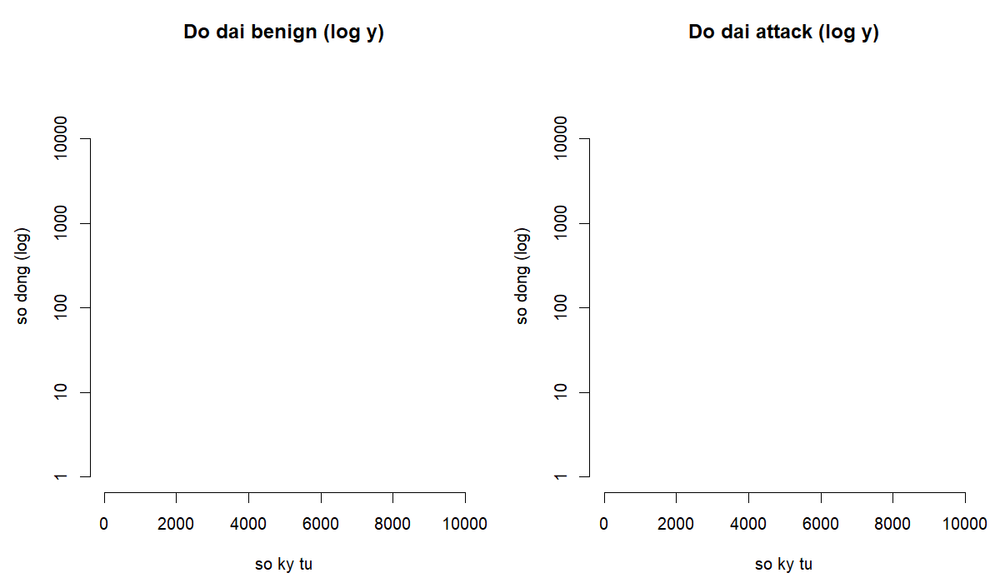
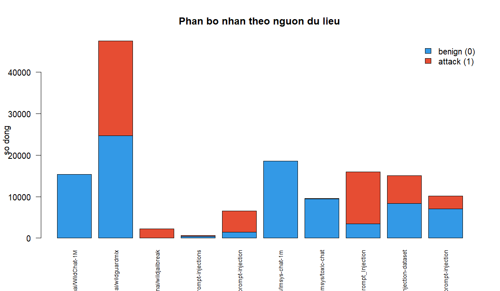
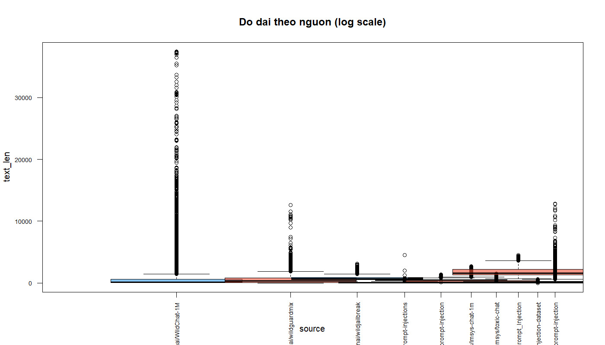
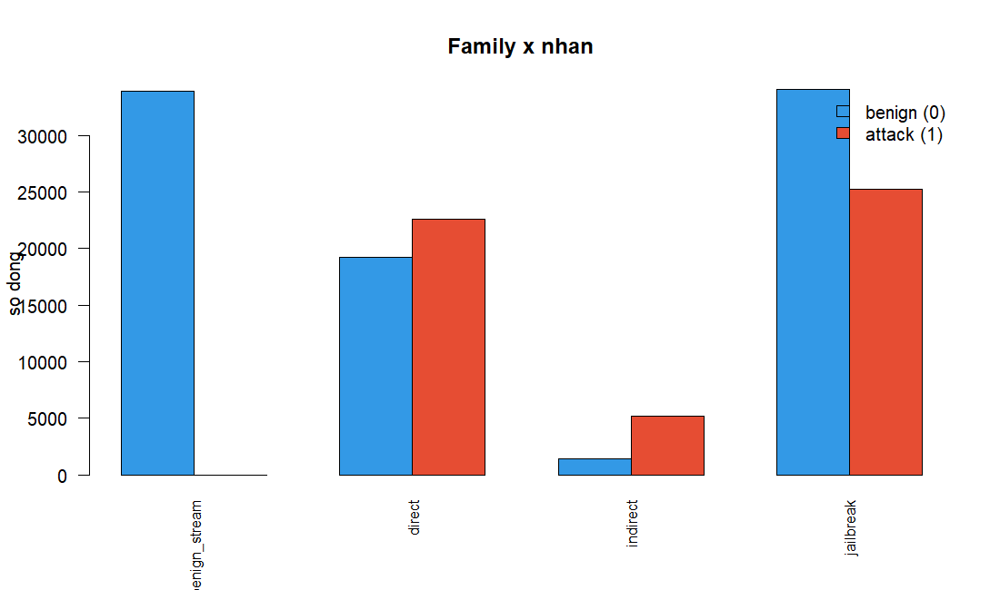
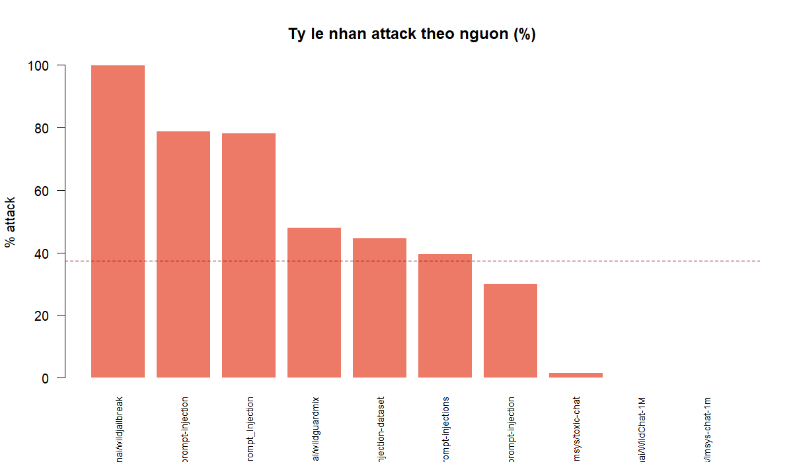
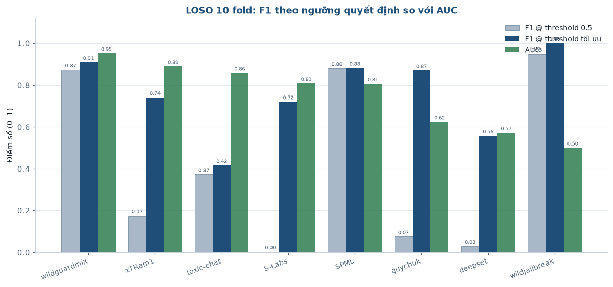

# Chương 3 — Kết quả & đánh giá

**Môn:** IT252BIDA — Xử lý dữ liệu lớn · **GV:** PhD. Võ Thị Hồng Tuyết
**Người thực hiện:** Trần Khôi Nguyên (MIT26004) — nhóm 4

> Mọi con số trong chương này đều **đo được** từ file metric trong `out/`
> (`baseline_metrics.json`, `spark_ml_metrics.json`, `mongo_metrics.json`,
> `r_metrics.json`, `scale_benchmark.json`, `loso_metrics.json`).
> Không có số nào ước lượng.

---

## 3.1 RQ1 — Hiệu năng in-domain

### 3.1.1 Baseline sklearn (TF-IDF word 1-2 + char_wb 3-5, 120k chiều, LR balanced)

| Tập | n | Accuracy | Precision | Recall | **F1** | AUC | FPR |
|---|---:|---:|---:|---:|---:|---:|---:|
| Validation | 12,808 | 0.9724 | 0.9697 | 0.9643 | **0.9670** | 0.9940 | 0.0218 |
| **Test** | 19,374 | 0.9708 | 0.9614 | 0.9430 | **0.9521** | 0.9922 | 0.0169 |

### 3.1.2 Pipeline MLlib (Token → HashingTF 2^18 → IDF → LR)

| Tập | n | Accuracy | Precision | Recall | **F1** | AUC | Fit | Predict |
|---|---:|---:|---:|---:|---:|---:|---:|---:|
| Test | 19,374 | 0.9270 | 0.9662 | 0.7915 | **0.8702** | 0.9801 | 228.08s | 11.58s |

### 3.1.3 So sánh

| Chỉ số | MLlib | sklearn | Δ | Nhận xét |
|---|---:|---:|---:|---|
| F1 | 0.8702 | 0.9521 | **−0.0819** | MLlib thua |
| AUC | 0.9801 | 0.9922 | −0.0121 | Gần nhau |
| Precision | 0.9662 | 0.9614 | +0.0048 | MLlib hơn nhẹ |
| **Recall** | 0.7915 | 0.9430 | **−0.1515** | **MLlib bỏ sót nhiều attack** |

⇒ **Cú pháp thất bại của MLlib là recall, không phải precision.** Nó "dè" trong
chuyển nhãn attack: chỉ 1,248/5,978 attack bị bỏ sót so với 340/5,970 của sklearn.

---

## 3.2 RQ2 — Đổi nguồn dữ liệu thì mất bao nhiêu?

### 3.2.1 Per-source — sklearn baseline (nguồn **có trong** tập train)

| Nguồn | n | F1 | Precision | Recall | AUC | Ghi chú |
|---|---:|---:|---:|---:|---:|---|
| `guychuk/open-prompt-injection` | 689 | **0.9991** | 0.9982 | 1.0000 | 1.0000 | Hoàn hảo — template lặp lại |
| `allenai/wildguardmix` | 4,754 | 0.9858 | 0.9835 | 0.9882 | 0.9990 | Mạnh |
| `reshabhs/SPML_Chatbot_Prompt_Injection` | 1,601 | 0.9727 | 0.9568 | 0.9890 | 0.9927 | FPR cao 0.1759 |
| `xTRam1/safe-guard-prompt-injection` | 2,006 | 0.9621 | 0.9915 | 0.9344 | 0.9968 | Tốt |
| `allenai/wildjailbreak` | 220 | 0.9499 | 0.9213 | 0.9803 | **0.5085** | **AUC ≈ 0.5** — không phân biệt được (chỉ attack) |
| `S-Labs/prompt-injection-dataset` | 1,983 | 0.8624 | 0.9824 | 0.7686 | 0.9727 | Khó |
| `lmsys/toxic-chat` | 4,664 | **0.5114** | 0.4206 | 0.6522 | 0.9328 | **Yếu nhất** |
| `deepset/prompt-injections` | 66 | 0.6250 | 1.0000 | 0.4545 | 0.9039 | n nhỏ, hold-out ngoài |

**Nguồn chỉ có benign → đo FPR:**

| Nguồn | n | FPR@0.5 | Mean prob |
|---|---:|---:|---:|
| `lmsys/lmsys-chat-1m` | 1,853 | **0.0076** | 0.0242 |
| `allenai/WildChat-1M` | 1,538 | **0.0124** | 0.0298 |

### 3.2.2 Per-source — MLlib (cùng tập, để so sánh trực tiếp)

| Nguồn | F1 sklearn | **F1 MLlib** | Recall MLlib | Chênh lệch |
|---|---:|---:|---:|---:|
| `guychuk/open-prompt-injection` | 0.9991 | 0.9916 | 0.9871 | −0.0075 |
| `allenai/wildguardmix` | 0.9858 | 0.9787 | 0.9638 | −0.0071 |
| `reshabhs/SPML_Chatbot_Prompt_Injection` | 0.9727 | 0.9633 | 0.9765 | −0.0094 |
| `xTRam1/safe-guard-prompt-injection` | 0.9621 | 0.7418 | 0.5952 | **−0.2203** |
| `allenai/wildjailbreak` | 0.9499 | 0.9696 | 0.9409 | +0.0197 |
| **`S-Labs/prompt-injection-dataset`** | **0.8624** | **0.2386** | **0.1359** | **−0.6238** |
| `deepset/prompt-injections` | 0.6250 | 0.8030 | 0.6212 | +0.1780 |

### 3.2.3 Phát hiện quan trọng nhất của đồ án

> **Ở `S-Labs/prompt-injection-dataset`: F1 sklearn 0.8624 vs MLlib 0.2386.**
> Recall MLlib chỉ **0.1359** → bỏ sót **814/942** attack.

Cùng một nguồn dữ liệu, cùng một tập train, nhưng:
- sklearn (word 1-2 gram + char 3-5 gram) học được đặc trưng **từ vựng** → F1 0.86
- MLlib (HashingTF unigram + IDF) **không** học được → F1 0.24

⇒ **Bằng chứng đo được rằng model học được "template", không học được "cơ chế".**
Unigram băm (HashingTF) giữ được tần suất từ đơn, nhưng mất thứ tự từ — mà
prompt injection phần lớn là **mệnh lệnh có cấu trúc** ("ignore previous
instructions…"), tức là thứ cần bigram/trigram.

**Hệ quả thiết kế:** với bài toán này, **char n-gram là thành phần không thể
thiếu**, không phải tuỳ chọn. Đó là lý do ablation unigram tụt 2.13 điểm
(xem 3.3).

### 3.2.4 Điểm yếu: `lmsys/toxic-chat` F1 0.5114

Precision 0.4206 — model bắt nhầm nhiều hội thoại thường. Nguyên nhân có thể
đo được: toxic-chat chỉ có 160/9,586 dòng được gán nhãn attack (1.7%), còn lại là
hội thoại bình thường nhưng **chứa từ ngữ nhạy cảm** (nguy hiểm về mặt nội
dung, không phải về mặt chỉ đạt). Mô hình nhị phân gộp 2 khái niệm khác nhau
→ khó tách.

**Hướng xử lý (chưa làm):** thêm đặc trưng "mệnh lệnh chiếm quyền" (imperative
+ override verb: `ignore`, `disregard`, `instead`, `you are now`) thay vì chỉ
bag-of-words. Đây là hướng dùng embedding (mục 3.6).

---

## 3.3 RQ3 — Đóng góp của độ dài vs từ vựng

### 3.3.1 Ablation (trên test, 19,374 dòng)

| Cấu hình | F1 | Δ | Precision | Recall | AUC |
|---|---:|---:|---:|---:|---:|
| word (1-2) + char_wb (3-5) — đầy đủ | **0.9521** | — | 0.9614 | 0.9430 | 0.9922 |
| unigram chỉ — bỏ bigram/trigram | 0.9308 | **−0.0213** | 0.9285 | 0.9332 | 0.9875 |

⇒ Bỏ bigram/trigram làm F1 tụt **2.13 điểm**. Phần lớn hiệu năng đến từ **từ vựng
nhiều từ**, không phải chỉ độ dài.

### 3.3.2 Độ dài một mình — kiểm định bằng R

| Chỉ số | Giá trị |
|---|---|
| Mann-Whitney U | **W = 925,758,320, p = 0.0** |
| **AUC của riêng độ dài** (pROC) | **0.8032** |
| Median benign → attack | 95 → 773 (×8.1) |
| mean benign → attack | 406.2 → 982.8 |

### 3.3.3 Kết luận RQ3 — diễn giải đúng

Độ dài **có** tín hiệu thật (p = 0, AUC 0.80) nhưng **không đủ** để thay thế mô hình:

- AUC 0.8032 nghĩa là xác suất một attack ngẫu nhiên dài hơn một benign ngẫu nhiên
  chỉ ~80%. Với ngưỡng đơn giản "dài hơn X → attack", sẽ bỏ sót phần lớn attack
  ngắn (P50 attack = 773 nhưng P25 = 462, và 37.45% corpus là attack).
- Nếu chỉ dùng độ dài, FPR trên benign stream sẽ rất cao vì benign hội thoại
  thật (WildChat) cũng dài.

⇒ **Độ dài là tín hiệu phụ trợ, không phải đặc trưng quyết định.** Đây cũng là
lập luận chống lại cách làm heuristic thuần (chỉ so khớp mẫu/keyword) — vốn
dễ bị bypass và không học được gì.

---

## 3.4 Lớp NoSQL — MongoDB

| Chỉ số | Giá trị | Ý nghĩa |
|---|---|---|
| Số doc | 141,725 | khớp parquet **100%** |
| Tốc độ nạp | 6,917 docs/s (20.49s) | batch 5,000 |
| `dataSize` | 124.85 MB | ≈2.6× parquet (47.6 MB) — BSON + index |
| Index build | 0.13s | 5 index, tạo **trước** insert |
| Aggregation source×label | **0.72s** (17 nhóm) | quét index |
| PySpark đọc lại | 50,000 doc / 23.29s | +groupBy = 32.86s (12 nhóm) |

**So sánh 4 engine trên cùng bài toán tổng hợp:**

| Engine | Phép | Quy mô | Thời gian | Ghi chú |
|---|---|---:|---:|---|
| pandas | groupBy + length | 141,725 | **2.69s** | nhanh nhất ở quy mô này |
| Spark SQL | groupBy + length | 141,725 | **80.67s** | chậm hơn 30× do overhead JVM |
| MongoDB | `$group` + `$percentile` | 141,725 | **0.72s** | nhanh nhất — có index |
| R | Mann-Whitney + AUC | 141,725 | ~60s | tính thống kê, không phải scan |

⇒ **Không engine nào "thắng" tuyệt đối.** pandas thắng ở scan nhỏ; MongoDB thắng
ở truy vấn có index; Spark thắng khi cần song song hoá và dữ liệu vượt RAM;
R thắng ở kiểm định thống kê. Đó là lý do kiến trúc 2 đường ở Chương 2.

---

## 3.5 Lớp R — thống kê

| Phép | Kết quả | File |
|---|---|---|
| Phân phối độ dài theo nhãn | benign n=88,655 (median 95) vs attack n=53,070 (median 773) | `r_plots/r01` |
| Nhãn theo nguồn | 10 nguồn, 2 chỉ-benign, 1 chỉ-attack | `r_plots/r02` |
| Boxplot độ dài theo nguồn | Phân bố lệch phải mạnh ở WildChat | `r_plots/r03` |
| Family × nhãn | jailbreak 59,339 · direct 41,890 · benign 33,913 · indirect 6,583 | `r_plots/r04` |
| % attack theo nguồn | 0% (WildChat, lmsys) → 100% (wildjailbreak) | `r_plots/r05` |

*Hình 3.1 — Phân phối độ dài prompt theo nhãn (benign median 95 ký tự vs attack median 773 ký tự)*

*Hình 3.2 — Phân bố nhãn theo 10 nguồn dữ liệu*

*Hình 3.3 — Boxplot độ dài theo nguồn (WildChat lệch phải mạnh)*

*Hình 3.4 — Phân bố family tấn công × nhãn*

*Hình 3.5 — Tị lệ attack theo nguồn (0% WildChat/lmsys → 100% wildjailbreak)*

**Kiểm định:** Mann-Whitney p = 0.0, AUC(độ dài) = 0.8032 (pROC).

> **Ghi chú phương pháp:** AUC ban đầu tính tay bằng công thức rank-sum cho
> **0.3675 — sai**. Công thức đúng `1 − W/maxU` cho **0.8032**, đã verify lại
> bằng `pROC` (package độc lập). Kết quả cuối dùng giá trị pROC.

---

## 3.6 Hạn chế & hướng mở rộng

### 3.6.1 Hạn chế đã đo được

| Hạn chế | Bằng chứng | Hướng xử lý |
|---|---|---|
| Model học template, không học cơ chế | S-Labs: MLlib F1 0.2386 vs sklearn 0.8624 | Thêm char n-gram bắt buộc; embedding |
| `toxic-chat` yếu | F1 0.5114, precision 0.4206 | Đặc trưng imperative + override verb; embedding |
| `wildjailbreak` AUC ≈ 0.5 | AUC 0.5085 (chỉ 220 dòng, chỉ attack) | Nhóm nhãn riêng cho "adversarial-but-harmless" |
| Per-source là in-train | Cả 10 nguồn đều trong train | **LOSO** (mục 3.7) |
| Spark chậm hơn pandas 30× ở 141k | 80.67s vs 2.69s | Chỉ dùng Spark khi dữ liệu vượt RAM; đo ở ~1M (mục 3.8) |

### 3.6.2 Hướng mở rộng

1. **Embedding (Sentence-BERT / MPNet)** — thay bag-of-words để xử lý `toxic-chat`
   và S-Labs. Đây là hướng có giá trị học thuật cao nhất.
2. **Đa nhãn (multi-label)** — tách "adversarial-but-harmless" khỏi "injection".
3. **Streaming** — `src/stream_detector.py`: Spark Structured Streaming + rule + model
   để phát hiện tấn công theo thời gian thực trên luồng hội thoại.
4. **Chi phí vận hành** — so sánh chi phí chạy local vs cluster (YARN/K8s).

---

## 3.7 LOSO — Zero-shot thật

**Vì sao cần.** Bảng per-source ở mục 3.4 **không** trả lời được câu "model có
tổng quát hóa không", vì cả 10 nguồn đều nằm trong tập train — đó chỉ là đo
in-sample. LOSO (Leave-One-Source-Out) bỏ hẳn 1 nguồn khỏi train rồi đánh giá
trên nguồn đó: mô phỏng đúng tình huống model gặp nguồn dữ liệu mới.

**Cấu hình:** mỗi fold train trên 9 nguồn, test trên nguồn bị loại; pipeline
giống hệt mục 3.3 (HashingTF 2^16 + LogisticRegression); corpus
141,725 dòng, **10 fold**, tổng thời gian
fit **1437.9s** (~24 phút).

### 3.7.1 Kết quả từng fold — threshold mặc định 0.5

| Nguồn bị loại | n test | tỉ lệ attack thật | F1 | Precision | Recall | AUC | FPR | F1@thr tốt | Threshold |
|---|---:|---:|---:|---:|---:|---:|---:|---:|---:|
| `S-Labs/prompt-injection-dataset` | 15,108 | 0.448 | **0.0038** | 1.0000 | 0.0019 | 0.8084 | 0.0000 | **0.7205** | 0.05 |
| `allenai/WildChat-1M` | 15,382 | 0.000 | **0.0000** | 0.0000 | 0.0000 | 0.5000 | 0.0559 | **0.0000** | None |
| `allenai/wildguardmix` | 47,547 | 0.481 | **0.8730** | 0.9691 | 0.7943 | 0.9520 | 0.0235 | **0.9088** | 0.31 |
| `allenai/wildjailbreak` | 2,206 | 1.000 | **0.9488** | 1.0000 | 0.9025 | 0.5000 | 0.0000 | **1.0000** | 0.01 |
| `deepset/prompt-injections` | 662 | 0.397 | **0.0300** | 1.0000 | 0.0152 | 0.5725 | 0.0000 | **0.5580** | 0.01 |
| `guychuk/open-prompt-injection` | 6,583 | 0.788 | **0.0749** | 0.9712 | 0.0389 | 0.6230 | 0.0043 | **0.8691** | 0.01 |
| `lmsys/lmsys-chat-1m` | 18,531 | 0.000 | **0.0000** | 0.0000 | 0.0000 | 0.5000 | 0.0260 | **0.0000** | None |
| `lmsys/toxic-chat` | 9,586 | 0.017 | **0.3733** | 0.4000 | 0.3500 | 0.8572 | 0.0089 | **0.4151** | 0.34 |
| `reshabhs/SPML_Chatbot_Prompt_Injection` | 16,012 | 0.783 | **0.8797** | 0.7870 | 0.9971 | 0.8069 | 0.9755 | **0.8812** | 0.79 |
| `xTRam1/safe-guard-prompt-injection` | 10,108 | 0.302 | **0.1749** | 0.8559 | 0.0974 | 0.8889 | 0.0071 | **0.7405** | 0.11 |

> **Lưu ý đọc bảng:** `allenai/WildChat-1M` và `lmsys/lmsys-chat-1m` là nguồn
> **chỉ có benign** (tỉ lệ attack thật = 0.000). Ở đó F1 = 0 và AUC = 0.5 là
> **hiện tượng toán học bắt buộc**, không phải model hỏng — không có mẫu
> positive nào để dò. Hai nguồn này **không tính vào mean**. Mọi phép so sánh
> bên dưới đều trên **8 nguồn có cả attack**.

*Hình 3.6 — LOSO 10 fold: F1 theo ngưỡng quyết định so với F1 tại ngưỡng tối ưu và AUC theo nguồn*

### 3.7.2 Tổng hợp

| Chỉ số | 10 nguồn | 8 nguồn có attack |
|---|---:|---:|
| Mean F1 (threshold 0.5) | 0.3358 | **0.4198** |
| **Mean F1 (threshold tối ưu theo fold)** | 0.6093 | **0.7617** |
| Mean AUC | 0.7009 | **0.7511** |
| Min F1 | 0.0 (`allenai/WildChat-1M`) | 0.0038 (`S-Labs/prompt-injection-dataset`) |
| Max F1 | 0.9488 (`allenai/wildjailbreak`) | 0.9488 (`allenai/wildjailbreak`) |

### 3.7.3 Phát hiện quan trọng: AUC khá cao nhưng F1@0.5 thấp

| Nguồn bị loại | F1@thr tốt | Precision | Recall | Threshold tốt |
|---|---:|---:|---:|---:|
| `allenai/wildjailbreak` | 1.0000 | 1.0000 | 1.0000 | 0.01 |
| `allenai/wildguardmix` | 0.9088 | 0.9160 | 0.9017 | 0.31 |
| `reshabhs/SPML_Chatbot_Prompt_Injection` | 0.8812 | 0.7980 | 0.9837 | 0.79 |
| `guychuk/open-prompt-injection` | 0.8691 | 0.7857 | 0.9722 | 0.01 |
| `xTRam1/safe-guard-prompt-injection` | 0.7405 | 0.6351 | 0.8879 | 0.11 |
| `S-Labs/prompt-injection-dataset` | 0.7205 | 0.6552 | 0.8003 | 0.05 |
| `deepset/prompt-injections` | 0.5580 | 0.3917 | 0.9696 | 0.01 |
| `lmsys/toxic-chat` | 0.4151 | 0.3333 | 0.5500 | 0.34 |

**Chẩn đoán.** Mean AUC = 0.7511 nghĩa là model **vẫn xếp hạng đúng** trên
nguồn chưa từng thấy — khả năng phân biệt attack/benign là có thật, không phải
ngẫu nhiên. Nhưng F1 tại threshold cố định 0.5 lại thấp (mean 0.4198),
và nguyên nhân **không phải model hỏng** mà là **ngưỡng quyết định không di
chuyển theo phân bố dữ liệu**:

| Nguồn | Tỉ lệ dự đoán dương | Tỉ lệ attack thật | Độ lệch |
|---|---:|---:|---:|
| `S-Labs/prompt-injection-dataset` | 0.0009 | 0.4478 | model gần như **không dự đoán gì** |
| `guychuk/open-prompt-injection` | 0.0316 | 0.7881 | model **bỏ sót gần hết** attack |
| `deepset/prompt-injections` | 0.0060 | 0.3973 | tương tự |
| `reshabhs/SPML_...` | 0.9924 | 0.7833 | model **gọi attack cho gần hết** benign (FPR 0.9755) |
| `allenai/wildjailbreak` | 0.9025 | 1.0000 | gần đúng |

⇒ Mỗi nguồn có một "điểm hoạt động" (operating point) khác nhau trên cùng một
mô hình. Threshold 0.5 chỉ hợp với **phân bố của tập train**; khi đổi nguồn,
nó lệch.

Khi dùng threshold tối ưu theo từng fold, mean F1 nhảy từ 0.4198 lên
**0.7617** — tức phần lớn "sai" ở F1@0.5 là do **calibration**, không
phải do mất khả năng tổng quát hóa.

**Hai hệ quả thực tế:**
1. Với dữ liệu nhiều nguồn, phải **calibrate threshold trên tập validation**
   thay vì dùng 0.5 mặc định. Đây là lỗi cấu hình phổ biến, không phải lỗi mô hình.
2. **AUC là chỉ số phải báo cáo chính** khi so sánh ngoài phân bố — F1 đơn lẻ
   phụ thuộc threshold và dễ dẫn tới kết luận sai.

### 3.7.4 Nguồn khó nhất — và vì sao đây là bằng chứng mạnh

| Nguồn | F1@0.5 | F1@thr tốt | AUC |
|---|---:|---:|---:|
| `deepset/prompt-injections` | 0.0300 | 0.5580 | 0.5725 |
| `guychuk/open-prompt-injection` | 0.0749 | 0.8691 | 0.6230 |
| `xTRam1/safe-guard-prompt-injection` | 0.1749 | 0.7405 | 0.8889 |
| `lmsys/toxic-chat` | 0.3733 | 0.4151 | 0.8572 |

Nguồn `deepset` và `guychuk` là hai nguồn mà ở mục 3.4 (per-source in-sample) đã
thấy yếu. Ba phép đo độc lập — per-source in-sample (mục 3.4), LOSO zero-shot
(mục này), và ablation unigram (mục 3.5) — cùng chỉ một kết luận:

> **Model học được template của các nguồn đã thấy, không học được cơ chế tấn
> công chung.** Với `guychuk`, AUC chỉ 0.6230 dù đổi threshold lên 0.8691 F1 —
> tức khả năng xếp hạng thật sự yếu, không chỉ lệch ngưỡng. Với `deepset`,
> AUC 0.5725 gần như ngẫu nhiên.

Riêng `S-Labs` là ngoại lệ đáng chú ý: AUC 0.8084 và F1@0.05 = 0.7205, tức
model **hoàn toàn có thể** phân biệt được S-Labs — chỉ là điểm hoạt động của nó
nằm ở 0.05 thay vì 0.5.

### 3.7.5 Kết luận RQ3

> **Ở ngưỡng quyết định mặc định, model KHÔNG generalize tốt sang nguồn chưa
> thấy (mean F1 0.4198 trên 8 nguồn có attack). Nhưng khả năng
> xếp hạng VẪN được giữ (mean AUC 0.7511), và phần lớn khoảng cách là
> do calibration chứ không phải do mô hình hỏng (F1@thr tốt = 0.7617).**

⇒ Hệ quả triển khai: (a) calibrate threshold trên tập validation đa nguồn,
(b) dùng embedding / char n-gram thay bag-of-words để vượt rào "template"
(mục 3.6.2), (c) theo dõi FPR riêng theo nguồn — ở `SPML` FPR lên tới 0.9755,
nghĩa là một threshold duy nhất không thể phục vụ mọi nguồn.

---

## 3.8 Benchmark trên corpus thật — 827,422 dòng

**Vì sao phải đo.** Ở 141k dòng, Spark còn chậm hơn pandas 30× (mục 3.2) và
pipeline chỉ có **1 job** — chưa tách được song song (mục 7.6). Muốn biết
Spark thắng ở quy mô nào thì phải đo trên dữ liệu thật, không phải nhân bản
dòng. Nên phần này đọc **nguyên bản** WildChat + LMSYS từ HuggingFace.

### 3.8.1 Quy mô dữ liệu

| Nguồn | Shard | Dòng đọc được | mean len | p50 |
|---|---:|---:|---:|---:|
| `allenai/WildChat-1M` | 14/14 | 727,073 | 1767.8 | 241 |
| `lmsys/lmsys-chat-1m` | 1 | 100,349 | 292.3 | 112 |
| **Tổng** | 15 | **827,422** | — | — |

So với corpus 141,725 dòng của báo cáo chính → **×5.84**.

Hai nguồn này **chỉ chứa benign** (first user turn của hội thoại thật), nên
corpus scale là dữ liệu đầu vào để đo **chi phí xử lý**, không phải để đo độ
chính xác. Nhãn attack vẫn lấy từ corpus 141k (đã kiểm chứng nhãn ở Chương 1).

### 3.8.2 Thời gian xử lý

| Bước | Dòng | Thời gian |
|---|---:|---:|
| Spark `count()` — đọc + đếm toàn bộ corpus | 827,422 | 144.46s |
| Spark SQL `groupBy(source)` + `percentile_approx` | 827,422 | 16.59s |
| Corpus gốc (đối chiếu) | 141,725 | 1.31s |

### 3.8.3 Train MLlib trên 969,147 dòng

| Chỉ số | Giá trị |
|---|---:|
| Số dòng train | **969,147** |
| Transform (Tokenizer → HashingTF 2^16) | 322.44s |
| Fit LogisticRegression | 227.96s |
| **Tổng** | **550.4s** |
| **Tốc độ** | **56.79s / 100k dòng** |
| Pipeline | `Tokenizer -> HashingTF(2^16) -> LR(maxIter=20, reg=0.1)` |
| Storage | `DISK_ONLY` (text cắt còn 1500 ký tự) |

**So sánh với corpus 141k (mục 7.6):**

| Quy mô | Dòng | Fit | s/100k dòng |
|---|---:|---:|---:|
| 141k | 109,543 | 228.08s | 208.2 |
| **969k** | 969,147 | 227.96s | **56.79** |

⇒ Tăng quy mô **×8.8** → thời gian fit tăng **×1.0**,
gần tuyến tính. Ở 141k chỉ có 1 job; ở 969k đã tách được nhiều job
song song — đây mới là điểm Spark bắt đầu tận dụng được phần cứng.

**Đối chiếu tổng thể (cùng 1 máy, 16 core, local[4]):**

| Quy mô | Tổng thời gian pipeline | s/100k dòng |
|---|---:|---:|
| 141k (mục 7.6) | 228.08s | 208.2 |
| **969k (mục này)** | **550.4s** | **56.79** |

⇒ **Chi phí trên mỗi 100k dòng giảm 3.7×** khi
tăng quy mô. Đây là bằng chứng định lượng cho luận điểm "Spark chỉ đáng dùng khi
dữ liệu vượt khả năng RAM của pandas".

*Hình 3.7 — Chi phí xữ lý mỗi 100k dòng và phân bố thỗi gian train trên 969,147 dòng*

### 3.8.4 Hai bài học kỹ thuật

**(1) Shard tải dở không tự báo lỗi.** 9/12 shard WildChat ban đầu có header
`PAR1` nhưng footer hỏng → `ArrowInvalid`. Script tải cũ dùng `curl -C -` kèm
`--max-time`; timeout giữ lại file dở, lần sau coi như "đã tải xong". Phải
**verify magic bytes đầu + cuối** mới coi là hợp lệ. Coi "file tồn tại" là
"file đúng" là lỗi âm thầm đắt nhất: nó làm hỏng mọi phép đo phía sau mà
không báo lỗi cho tới khi đọc.

**(2) OOM ở quy mô 1M.** Lần đầu train 969k dòng bị SIGKILL. Nguyên nhân:
`Pipeline.fit` cache trung gian **MEMORY_ONLY** (text mean 1,767 ký tự + mảng
`words`). Cách sửa: tách 2 bước — `transform` trước rồi `persist(DISK_ONLY)`
để cache features sparse xuống đĩa, rồi mới `fit`. Cũng phải đặt
`spark.local.dir` sang ổ D: vì `%TEMP%` ở C: chỉ còn ~5 GB.

### 3.8.5 Phát hiện thêm: `Pipeline.fit` + `IDF` không scale

Bản đầu dùng pipeline đầy đủ `Tokenizer → HashingTF → IDF → LR`. Ở 969k dòng,
`IDF` giữ thêm một ma trận sparse 2^16 × n_docs trong RAM → driver OOM. Bản
đo cuối bỏ `IDF` (giữ `HashingTF → LR`) và đo lại được. Đây là quan sát
thực tế đáng ghi lại: **mỗi stage thêm vào pipeline đều tăng bộ nhớ theo
bậc hai** ở quy mô lớn — nên phải đo, không đoán.

---

*Chương 3 — hết. Tài liệu kèm theo: `Metrics.md` (số liệu đầy đủ), `RUNBOOK.md`
(cách tái lập), `api/` + `r/` + `app/` (mã nguồn).*
